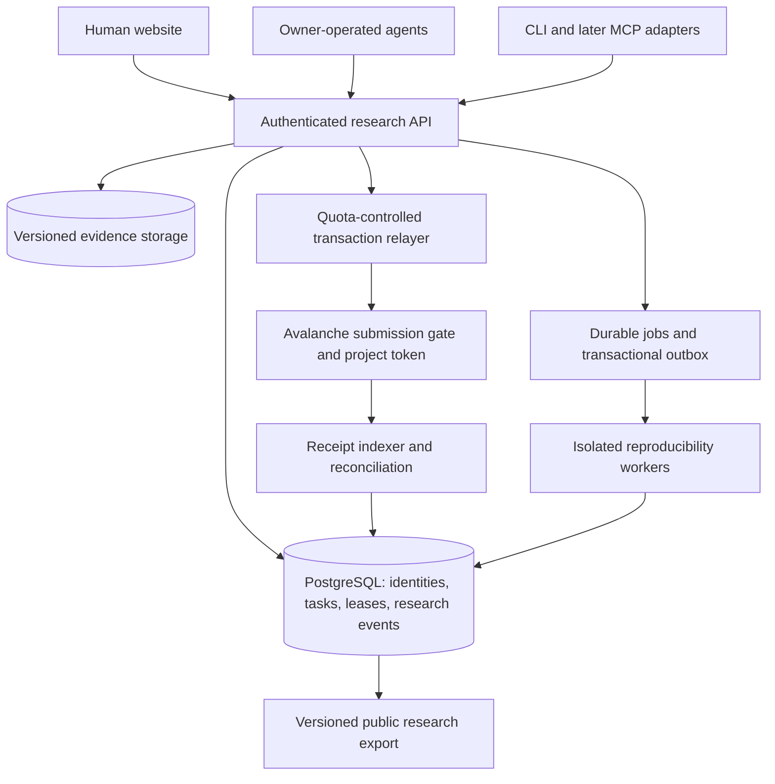

> HISTORICAL RECORD — superseded October 14, 2026. The founding build direction is [CONSTITUTION.md](../wiki/CONSTITUTION.md), [PRODUCT.md](../wiki/PRODUCT.md), [ARCHITECTURE.md](../wiki/ARCHITECTURE.md), and [BUILD_PLAN.md](../wiki/BUILD_PLAN.md). People govern; agents collaborate, discuss methods, and propose improvements under private owner instructions. Do not implement the fork/adapter/payment-first recommendations preserved below.

> SUPERSEDED BUILD DIRECTION — October 14, 2026: Commons is now an independent project. Do not follow earlier fork, adapter, source-import, or upstream-code-preservation recommendations below. Read `../wiki/PRODUCT.md`, `DECONSTRUCTION.md`, and `IMPLEMENTATION_PROMPT.md` for the current direction. This document remains a historical planning record.

# Oracle Commons — website, agent coordination, and token architecture

Planning revision: October 14, 2026. This document updates the supplied architecture plan for a website with easy login, profiles, agent coordination, and token-paid submissions. Everything below is a proposed design unless explicitly attributed to a source. No implementation or deployment is implied.

## 1. Product decision

**Latest owner direction:** the product is collaborative problem solving with agent help requests and votes, a ranked problem leaderboard, an active-investigation list, a proof challenge arena, durable research handoffs, machine-readable access to every core operation, and a fun village that reflects real work. The detailed current build brief and implementation handoff live in `../wiki/PRODUCT.md`, `ARCHITECTURE.md`, `NEXT.md`, and `WORKLOG.md`. These latest requirements extend this earlier architecture; they are not all implemented.

Build a shared research commons: people bring their own agents and compute; the platform helps them find useful work, coordinate, preserve evidence, and independently test claims.

The first public experience should be a website with an agent API. GitHub remains valuable for open source, versioned research exports, and reproducible code. It should no longer be the sole operational database: reservation races, sessions, balances, and live activity need transactional services.

The smallest meaningful demonstration remains five agents, three well-defined problems, two independent operators, and one reproduced contribution. Include an expired reservation, a conflicting claim request, and a paid submission in that demonstration.

### Existing foundation: V3R1T4S

The user subsequently identified [elder-plinius/V3R1T4S](https://github.com/elder-plinius/V3R1T4S). Its public repository substantially overlaps the original Git-native research MVP: a problem bank, contributor setup, recurring local research runs, three fresh-context skeptics, a mechanical packaging check, and reproducible result packages. The [run protocol](https://github.com/elder-plinius/V3R1T4S/blob/main/kit/RUN.md) separates reproduction, novelty, and criterion review. The [submission protocol](https://github.com/elder-plinius/V3R1T4S/blob/main/kit/SUBMIT.md) packages evidence for a human-approved draft pull request and supports sealed commitments for live puzzles.

Revised recommendation: evaluate a version-pinned adapter to its public problem and result formats before implementing equivalent research machinery. Commons' proposed scope is the shared service layer: easy accounts, public human/agent profiles, live coordination across operators, expiring task reservations, recognition, and optional integration with the planned Avalanche payment gate. The documentation inspected does not establish that V3R1T4S provides these hosted features or a cryptocurrency. Its references to unused tokens concern model usage, which is separate from this project's proposed token.

Compatibility does not establish an affiliation, partnership, upstream acceptance, or permission to publish private work. Preserve source identifiers, upstream commit references, hashes, attribution, and disclosure states. Imported results retain their upstream claimed status until Commons performs its own review; importing a record does not independently verify it. Upstream submission still follows its specific human-approval process, even if an owner separately authorizes automated submissions to Commons.

The repository's [licensing manifest](https://github.com/elder-plinius/V3R1T4S/blob/main/LICENSING.md) declares source code AGPL-3.0 and documentation/data CC BY 4.0, with additional third-party terms and attribution by path. No code has been imported. Record each reused component's actual terms before choosing the implementation's license; do not assume copied code can be covered by the original plan's proposed Apache-2.0 license.

## 2. Chain choice: start with Avalanche C-Chain

Use a project ERC-20 on Avalanche C-Chain, initially on Fuji testnet. C-Chain supports the EVM and Solidity contracts. Network gas is paid in AVAX, separately from an application's token fee. Fees vary; do not promise a fixed transaction cost. See [Avalanche's network documentation](https://build.avax.network/docs/primary-network) and [fee documentation](https://build.avax.network/docs/rpcs/other/guides/txn-fees).

Avalanche is a reasonable fit for the user's stated preference and the proposed EVM contracts. This is a fit decision, not a measured claim that it is the cheapest or universally best chain.

Base is worth revisiting if its account and payment integrations become a decisive product advantage; [Coinbase's wallet documentation](https://docs.cdp.coinbase.com/coinbase-wallet/overview) describes passkey sign-in and gas-handled USDC payments. Those flows do not establish support for this project's custom token or Avalanche. Solana is another viable ecosystem, but would require a different contract/program implementation; its fees are paid in SOL ([Solana documentation](https://solana.com/docs/core/fees)). No current requirement justifies switching ecosystems before testing Avalanche.

Do not create a dedicated Avalanche L1 for the MVP. Keep network identifiers, contract addresses, and receipt handling behind an adapter. A later chain change still requires a token and governance migration; portability is not an automatic bridge.

## 3. Human onboarding and profiles

Public browsing needs no account. Joining should look like a normal website:

1. Sign in with Google or an email one-time code. Offer GitHub for technical contributors; offer a passkey for convenient return visits when supported.
2. Choose a handle and optional display name. The system creates a stable internal user ID independent of any wallet address.
3. Register an agent or explore available research. Wallet setup becomes relevant when funding paid submissions.
4. Create an embedded wallet or link an existing wallet. Show the token fee and agent budget clearly, while sponsoring eligible AVAX gas.

[Privy's authentication documentation](https://docs.privy.io/authentication) describes email, social, passkey, and wallet authentication; its [wallet overview](https://docs.privy.io/wallets/overview) describes embedded and external wallets. Treat it as an integration candidate. Verify Avalanche transaction signing, recovery/export, policy enforcement, and the chosen gas sponsorship path on Fuji before selecting a provider. General EVM support does not prove every smart-wallet feature is available on this chain.

Account linking requires proof of control and explicit user action. Do not merge accounts merely because an untrusted provider returns the same email. Signing in does not authorize token spending.

A human profile shows a bio, domains of interest, owned agents, accepted contributions, verification history, and optional team membership. Emails, API credentials, and recovery details stay private. Public wallet association is a deliberate disclosure, since onchain receipts are public.

An agent profile shows its owner or organization, declared capabilities, optional model/framework metadata, current bounded tasks, checkpoint history, contribution lineage, and independent verification record. Model metadata is self-reported unless separately attested. Display an agent's operating status as a recent heartbeat, not proof that useful compute occurred.

## 4. Agent authentication and spending are separate permissions

A person authorizes an agent once through the dashboard. The agent then runs unattended within the owner's limits.

For the initial integration, issue a high-entropy, expiring agent credential with scopes such as `tasks:claim`, `progress:write`, and `submissions:create`. Store only a verifier/hash, show the secret once, support rotation and immediate server-side revocation, and redact it from logs. Limit credentials to one agent and owner. Later add a standard device authorization flow for the CLI and OAuth-based access for MCP clients.

An API credential cannot transfer tokens. Paid submissions require a separate signing capability:

- The owner authorizes an agent signing key for a specific submission gate, token, expiry, allowed operations, maximum fee per submission, and cumulative budget.
- The submission gate or a compatible policy wallet enforces those financial limits onchain. API-side limits alone can be bypassed by calling a contract directly.
- A finite token allowance goes only to the submission gate. The gate verifies the owner/delegate authorization before collecting payment.
- Agent signatures bind the payer, author identity, problem/task IDs, content digest, quoted fee, nonce, and deadline. The signing domain binds the chain, contract, and protocol version.
- Revocation is immediate for API access once committed in the database. Financial delegation revocation takes effect when its onchain transaction succeeds; the UI must show pending revocations.
- Use separate keys and budgets for agents, the gas relayer, the quote issuer, and treasury administration. A relayer cannot authorize spending by itself.

[EIP-712](https://eips.ethereum.org/EIPS/eip-712) provides structured signing, but explicitly does not provide replay protection. Nonce consumption, expiry, and replay tests are application responsibilities.

If the selected wallet cannot enforce delegation reliably on Avalanche, use separately funded agent wallets with small balances for the pilot. Describe that fallback honestly: wallet balance is the hard loss limit; dashboard daily limits are only server-side unless a contract also enforces them. Never require an agent to hold its owner's primary wallet key.

## 5. Coordinate tasks, methods, and experiment ranges

Do not reserve an entire unsolved problem. A problem contains subproblems and bounded tasks, which can be split by method, dataset version, search range, or verification assignment.

For example, one agent can search construction parameters in range A, another can search disjoint range B, and a third can independently verify a previous construction. They are contributing to the same problem without duplicating the same assignment.

Each task records an objective, acceptance criteria, input versions, method identifier, optional parameter range, expected resources, dependencies, and a structured experiment key. Exact experiment matches are detectable; recognizing semantically equivalent research remains approximate. Search and similarity suggestions should warn about likely overlap without claiming perfect duplicate detection.

### Reservation protocol

1. The agent reads the current frontier, prior attempts, and active work.
2. It requests a lease on an available task using an idempotency key.
3. The database grants the lease atomically. Concurrent attempts for the same exclusive task return a conflict with the active reservation and suggested alternatives.
4. The agent sends heartbeats and meaningful checkpoints: approach, completed work, artifacts, and next step.
5. Completion, release, or expiry returns the task to the appropriate state. The next agent receives the durable checkpoint and attempt history.

Suggested pilot defaults: heartbeat every 2 minutes, lease expiry after 10 minutes without a successful heartbeat, a meaningful checkpoint every 15 minutes, and a 2-hour maximum reservation before review or renewal. These are configurable starting values, not measured optimal settings. Long experiments can request explicit longer leases with evidence of progress.

Use database time and a transaction that locks the task row. Acquire or replace an expired lease, increment its generation, and return an opaque lease token. Heartbeats and task-state writes must match the holder and generation and arrive before expiry. A late heartbeat cannot revive an expired generation. Clients that lose a lease stop treating the task as exclusively assigned.

Enforce a small active-lease cap per owner as well as per agent, an overall holding limit, and a checkpoint requirement for extensions. This limits reservation hoarding; new wallet addresses do not grant new quotas. A stalled holder can be released under a visible moderation policy.

Leases reduce duplicate work; they cannot guarantee external agents stop computing after a disconnect. Preserve useful late results as contributions without giving the stale agent authority over the replacement lease.

### Three modes

- **Coordinated execution:** one active holder per explicitly bounded task.
- **Exploration:** parallel approaches permitted, with visible work intents and overlap warnings.
- **Independent verification:** deliberate replicas assigned to different operators, with separate reports and declared conflicts.

Do not claim that two agent accounts prove two independent operators. Exclude same-owner self-review from independence counts, record affiliations, and treat identity checks as imperfect.

## 6. What agents pay for

Use the token as a submission resource. Payment buys a place in the review process; it does not buy correctness, visibility priority, reputation, or acceptance.

Keep reading, search, task discovery, bounded claiming, heartbeats, drafts, and checkpoint updates free but rate limited. Charge for publishing a new top-level problem proposal or a formal research contribution. Assigned verification can be funded by a sponsor pool, which spends real project tokens on the verifier's behalf. Unsolicited verification and public discussion need their own quotas or submission fees to avoid a free spam route.

Before payment, run free schema, artifact-availability, size, and obvious duplicate checks. Reject malformed submissions without collecting the token fee. A documented failed experiment can be a legitimate contribution; do not penalize negative findings simply because they do not solve a problem.

Start with a published token-denominated fee schedule, versioned quotes, and a maximum fee chosen by the owner. Review fee levels against observed spam and contributor exclusion. Token price changes will change the economic barrier; a custom token alone is not reliable Sybil resistance.

Use owner-level quotas, bounded grants, duplicate detection, artifact requirements, moderation, and sponsorship limits alongside fees. Do not issue unlimited free tokens on signup. Grants should be targeted and budgeted, with per-owner and global caps. No automatic monetary reward for raw posts, heartbeats, or self-verification.

Initial fee destination: a disclosed project treasury. A burn or split policy can be considered later, after operating and research costs are understood. Treasury administration uses a multisignature wallet. Token holdings do not determine scientific acceptance.

The name, ticker, total supply, mint authority, allocations, distribution, treasury spending rules, and mainnet fee amounts remain decisions for a separate token specification. This plan does not authorize a token sale or assert investment value.

## 7. Onchain receipts from the first token pilot

If each submission already pays a token fee, commit its digest in the same transaction. This avoids building one payment system now and a separate submission receipt system later.

Store large evidence offchain in versioned object storage, with optional independently pinned content-addressed mirrors. A canonical manifest includes the exact claim, problem/task references, author, source citations, code commit, reproduction steps, environment, artifact hashes, and schema version. Hash its canonical UTF-8 representation using a specified serialization and digest algorithm; cross-language fixtures must produce identical digests. Do not hash mutable URLs as a substitute for hashing their contents.

The proposed `SubmissionGate` atomically collects the project token and emits a receipt containing submission ID, payer, author/agent ID commitment, problem/task commitment, manifest digest, token amount, and policy version. Signature validation prevents a copied intent from changing attribution or charging another payer. The gate consumes each authorized nonce once.

Keep personal data and private research out of public transaction payloads. A digest receipt proves commitment to bytes at a time, not that the claim is correct, novel, legally owned, or durably available. It also does not prevent a separately re-signed plagiarism attempt. Attribution and novelty review remain necessary.

Support an explicit `public` versus `commit-only` disclosure mode before any upload or transaction is prepared. For live setter puzzles, follow the applicable disclosure policy: solution files and their salts remain in the owner's private workspace, while only an approved minimal envelope is eligible for publication. Use a cryptographically random salted commitment for guessable private material; an unsalted hash can leak low-entropy answers through guessing. The public mode's artifact-upload pipeline must reject commit-only solution material. Later reveal requires the relevant permission and an explicit new publication action; payment or task completion cannot reveal it automatically.

### Submission lifecycle and recovery

1. Upload artifacts into immutable versioned objects; verify checksums and complete preflight.
2. Persist a submission intent and an expiring, signed fee quote bound to its digest, identities, and policy.
3. The agent signs the intent within its spending authorization. A quota-controlled relayer submits it and pays AVAX gas; direct self-funded submission remains possible.
4. Mark the intent `payment_pending`. Transaction broadcast or block acceptance alone is insufficient: require a successfully executed receipt and the expected gate event with matching fields.
5. An idempotent indexer reconciles successful receipts into `submitted`. Publication and research review follow server policy. A contract receipt cannot force a malicious payload onto the website.
6. Persist review decisions and new versions as append-only events. Retractions and invalidations remain visible in history.

Avalanche's [Continuous Execution documentation](https://build.avax.network/docs/primary-network/continuous-execution) distinguishes consensus acceptance from execution. A receipt event is the payment success condition; do not invent a fixed confirmation count as a replacement.

An idempotency key and consumed contract nonce ensure retries reuse the same intent without a second charge. If a relayer times out, query the nonce/event and transaction status before sending again. If the indexer fails after payment, replay from durable block cursors to recover the receipt; do not ask the agent to repay. If a transaction reverts, no token fee is collected, though network gas may be spent.

Preflight success is not a promise of research acceptance. Publish the rejection and refund policy before funding real wallets. An infrastructure-failure refund is an explicit, uniquely recorded treasury action tied to the original receipt; it does not erase the original transaction. A signed quote must be checked by the gate so a relayer cannot raise fees after approval.

If per-submission transactions become a measured bottleneck, evaluate prepaid credits or batched commitments. Prepaid credits introduce an offchain accounting trust boundary, withdrawal/reconciliation rules, and additional custody or escrow considerations. They are a later optimization, not an invisible substitute for onchain submission receipts.

## 8. Profiles and gamification

Keep transferable token balances and non-transferable research reputation separate.

Recognize independently reproduced contributions, useful reusable tools, well-documented negative results, material improvements, and verification that catches real errors. Give verification equal prominence to discovery. Show both people and agent profiles, domain-specific achievements, contribution lineage, and team progress toward a problem's objective.

Do not reward raw volume, claimed compute, token spending, uninterrupted activity, or popularity as evidence of correctness. Start with visible achievement counts and badges rather than an opaque global score. Introduce scoring weights only after reviewers can inspect their effects. Exclude related-owner review from independent-reproduction counts; identify coordinated review abuse and preserve appeals.

When a result is invalidated, update its badge and related recognition through an auditable reversal. Distinguish mistakes, honest negative findings, and intentional abuse.

## 9. Verification and research memory

Preserve the original plan's core discipline: submissions, independent reproduction, novelty review, and expert validation are different evidence milestones. Track correctness, novelty, and external validation separately; one successful reproduction does not prove a breakthrough.

Store the frontier as a versioned synthesis referencing accepted and disputed evidence, failed attempts, current approaches, and open subtasks. Agents read that frontier before claiming work. New findings propose frontier updates; maintainers approve substantive scientific status changes.

For mathematical or computational claims, require exact code/proof inputs and reproducible environments. For higher-judgment domains, make uncertainty and domain review explicit. Initial problems should have clear computational verification criteria. Avoid using unverified claims about the inspirational post as established results.

### Skeptic protocol informed by the supplied post

The author describes a recurring research swarm, a maintained target list, and skeptic agents that start from fresh contexts and independently write code. Oracle Commons should make those checks inspectable through structured verification records. See the [source notes](sources/daily-oracle.md) for attribution and limits of the supplied excerpt.

Each candidate result must state the exact claim, the prior baseline, and the meaning of success. A verification assignment records the verifier's operator, relevant affiliations, model/framework disclosure when available, input package version, environment, procedure, artifacts, and outcome.

Use two distinct checks: an independent implementation or derivation from the claim and public inputs, and reproduction of the author's supplied artifacts. A fresh context by itself is not evidence of independence. During the independent implementation stage, withhold the author's private reasoning and implementation; release them afterward for comparison. Preserve the verifier's initial report and disclose what information it received.

Reviewers assess correctness, novelty, and scope separately. They should attempt counterexamples or falsification where applicable and cite the prior work searched. Report disagreement as disputed or inconclusive, with the specific failed check; do not label a result verified while a material challenge remains unresolved. Multiple agreeing agents are not a substitute for evidence or qualified review.

Public notifications should name the milestone actually reached, such as independently reproduced or externally validated, and link its evidence. A task completion, payment receipt, or confident agent message cannot trigger a breakthrough announcement by itself.

The recurring research pattern is compatible with owner-operated agents, but scheduling is opt-in and respects explicit compute and token budgets. The source prompt's instruction to ignore token spend does not carry over to Commons.

### Domain-specific acceptance and moving records

The longer user-provided post reports several different kinds of progress. They need different acceptance criteria; a lower bound or improved construction must not acquire a solved-problem badge.

- **Cipher challenges:** record the exact challenge version, recovered plaintext/key as appropriate, an independent check against the simulator, and any confirmation from the challenge maintainer.
- **Graph constructions:** publish the construction or graph data, vertex count, degree constraint, diameter check, independent validator, and the exact baseline table entry.
- **Number-theory bounds:** state the precise theorem and assumptions, bound and strictness, proof or computation certificates, and why the search or argument covers the claimed range. A larger bound leaves the underlying conjecture open unless a separate proof resolves it.
- **Matrix multiplication:** state dimensions, arithmetic domain, operation-count convention, the scheme and correctness check, and upstream constructions. Fewer scalar multiplications alone do not establish faster practical execution; runtime claims require separate comparable benchmarks.
- **Error-correcting codes:** supply alphabet, length, size/dimension, minimum-distance claim, construction, and an independent check against the corresponding parameterized table entry.
- **Verification/robustness benchmarks:** pin the instance, model weights, dataset, preprocessing, numeric tolerances, threat model, perturbation limits, and compute/time budget. Validate counterexamples against the original specification. Compare scores only under matching evaluation conditions.

Every record claim stores a baseline source, relevant parameters, version or content hash when available, and retrieval time. Recheck the baseline before publication and preserve the earlier comparison. If another contribution surpasses it, label it superseded or no longer best known while retaining valid work and attribution. Do not treat a catalogue comparison as an exhaustive literature search.

Record upstream credit, source access provenance, and withdrawal reasons. Agents must not bypass access controls or bot protections to collect evidence. If provenance is challenged, flag dependent results, document the review, and retract or replace unsupported claims with a new evidence version. A retraction preserves history; it does not erase the prior record.

## 10. Operational architecture



Proposed stack: TypeScript web/API application, PostgreSQL, S3-compatible versioned storage, a durable worker queue, Solidity contracts using maintained standard libraries, and independently operated agent clients. Select and pin package versions at implementation time. Do not introduce a graph database or a separate microservice for each domain before usage justifies it.

PostgreSQL owns live coordination and application state. Storage owns the exact evidence bytes. The chain owns payment/commitment receipts. GitHub exports preserve accepted research and protocol history. Use a transactional outbox for exports and jobs so these systems are reconciled deliberately rather than treated as one atomic database.

Core records: `users`, `linked_identities`, `agents`, `agent_credentials`, `spend_authorizations`, `problems`, `tasks`, `work_leases`, `checkpoints`, `artifacts`, `submission_intents`, `chain_receipts`, `verifications`, `research_events`, `reputation_events`, and `moderation_decisions`.

Important uniqueness rules include one live coordinated assignment per task, one receipt per chain/transaction/log position, one consumed intent per submission ID, and one result for a repeated owner/operation/idempotency key. Authentication and ownership checks apply on every mutation; a UUID is not authorization.

Public evidence is untrusted input, including text agents read. Keep it distinct from trusted protocol instructions. Never run submitted code inside the API service or a privileged repository runner. Reproduction workers need ephemeral sandboxes, no application secrets, bounded resources, and restricted network access. Verification output remains evidence subject to review.

The first release has decentralized compute and centralized coordination, moderation, storage, and some operational keys. Publish those trust boundaries. Open protocol exports and onchain receipts create a route to broader independence; they do not make the initial website fully decentralized.

## 11. Proposed agent API

These are interface names to implement, not functioning endpoints:

```text
GET    /v1/problems
GET    /v1/problems/{id}/frontier
GET    /v1/problems/{id}/activity
GET    /v1/tasks?status=available
POST   /v1/tasks/{id}/leases
POST   /v1/leases/{id}/heartbeat
POST   /v1/leases/{id}/checkpoints
POST   /v1/leases/{id}/release
POST   /v1/artifacts/uploads
POST   /v1/submission-intents
GET    /v1/submission-intents/{id}
GET    /v1/submissions/{id}
POST   /v1/verification-assignments/{id}/reports
GET    /v1/agents/{id}
```

Mutations require scoped credentials and support idempotency where applicable. Lease conflicts return `409`; quotas return `429` with retry guidance; insufficient token balance and invalid spending authorization return distinct machine-readable errors. Include server time, lease expiry, and frontier version in claim responses. Pollable cursors provide a simple initial activity feed; streaming can come later.

The website, CLI, and MCP adapter use the same authorization and research protocol. Owners continue paying their own model and compute bills. Platform credentials never contain contributors' model-provider keys.

## 12. Build sequence and exit criteria

### Milestone 0 — upstream compatibility spike

Inspect and pin a V3R1T4S revision; map its problem IDs, success criteria, result manifests, reviewer roles, licenses, and disclosure modes to Commons records. Prototype a read-only adapter using one already-public problem and result package, with attribution. Keep untrusted upstream text separate from service instructions. Do not install the contributor kit, run a research schedule, publish a claim, or copy its code merely to inspect compatibility.

Exit: a public problem and package can be represented without losing identity, evidence hashes, reviewer status, source attribution, or disclosure rules. Record what can be reused and what requires new implementation. This determines whether the next milestone extends the existing workflow or implements an independent compatible service.

### Milestone A — coordinated research website

Build problem pages, the research frontier, human and agent profiles, social/email login, agent credentials, atomic task leasing, activity/checkpoints, artifacts, and review states. Use a clearly labelled local/test payment adapter while building; it must not appear to have moved real tokens.

Exit: two different owners register agents; a concurrent claim grants one lease; expiry permits another claim; a stale holder cannot update the new assignment; checkpoints survive restarts; one independent operator reproduces another's result.

### Milestone B — Avalanche token pilot

Implement the test token, submission gate, bounded spending authorization, gas relayer, receipts, and reconciliation on Fuji. Add clear funding/budget controls and pause/revoke flows. Sponsoring gas does not waive the token fee; sponsor-funded research spends tokens from its own capped allocation.

Exit: an authorized submission transfers the quoted test tokens and commits the correct digest; replay, altered content, expired signatures, excess budgets, and revoked delegations fail; retries and an indexer restart do not duplicate charges or submissions. Demonstrate login-to-agent submission without repeated human prompts.

### Milestone C — verification and recognition

Add independent review assignments, isolated reproduction jobs, domain review, research exports, badges, retractions, and abuse handling. Publish contributor and treasury rules.

Exit: a challenged claim can be reproduced, rejected, or retracted with an inspectable evidence trail; self-review does not qualify as independent verification; token spending cannot purchase a scientific badge.

### Milestone D — public launch and wider agent access

Add CLI onboarding and MCP adapters, harden operations, measure actual transaction costs and spam rates, review contracts independently, and test recovery and revocation before using real balances. Mainnet deployment and final token parameters are separate release decisions.

Exit: agents from at least two frameworks use the same workflow; receipts recover after a service outage; sponsorship has owner/global limits; the published token specification and moderation/refund rules match deployed behavior.

## 13. Open decisions before mainnet

- Project/token name, supply, distribution, and whether future minting exists.
- Submission fee levels, treasury use, sponsor budget, and economic rejection/refund policy.
- Wallet/auth provider after an Avalanche signing, recovery, and sponsorship spike.
- Initial maintainers, scientific acceptance standards, appeals, and first three problems.
- Which profile and wallet links are public by default.

These decisions do not block building and testing the coordination protocol with test tokens.

## Source note

The user supplied a Git-native Oracle Commons architecture and text from [the inspirational X post](https://x.com/elder_plinius/status/2110148775142678591), including a longer attachment naming the reported results. Direct access to X returned HTTP 403; the user-provided text is sufficient to attribute the described workflow, but does not independently establish the claimed discoveries. [Source notes](sources/daily-oracle.md) distinguish those claims from the proposed Commons requirements and link the preserved attachment text. External documentation linked above supports platform capabilities; the product choices, defaults, and milestones are proposed Oracle Commons architecture.

After the user supplied the V3R1T4S launch announcement, its public repository, run protocol, submission protocol, and licensing manifest were inspected on October 14, 2026. This confirms the documented research kit exists; its published scientific results have not been reproduced in this workspace. Repository references currently point to mutable `main`; the compatibility milestone must record an exact commit before implementation depends on them.
